  

  <a href="https://www.linkedin.com/in/shubham-sharma-7a1873263/"><b>LinkedIn</b></a> &nbsp;·&nbsp;
  <a href="https://portfolio-shubhamsharmayos-projects.vercel.app/"><b>Portfolio</b></a> &nbsp;·&nbsp;
  <a href="https://github.com/shubhamsharmayo"><b>GitHub</b></a>

## About

I build end-to-end products, from real-time collaborative tools to AI-driven data processing pipelines, with a focus on clean architecture and performance at scale.

| | |
|---|---|
| **Role** | Full Stack Developer |
| **Experience** | 1.5+ years in production environments |
| **Focus** | AI-powered platforms, real-time systems, scalable backends |
| **Education** | B.Tech in Computer Science, ITM Aligarh (2025) |
| **Location** | Maharashtra, India |

## Tech Stack

  

## Featured Projects

<table>
  <tr>
    <td width="50%" valign="top">
      <h3><a href="https://github.com/shubhamsharmayo/Image-Segmentation">Image-Segmentation</a></h3>
      
Real-time object detection and segmentation.

      <b>JavaScript</b>
    </td>
    <td width="50%" valign="top">
      <h3><a href="https://github.com/shubhamsharmayo/Onscreen-Marking-Software">Onscreen-Marking-Software</a></h3>
      
OMR evaluation and annotation tooling.

      <b>JavaScript</b>
    </td>
  </tr>
  <tr>
    <td width="50%" valign="top">
      <h3><a href="https://github.com/shubhamsharmayo/Evaluation_Module_NestJS">Evaluation_Module_NestJS</a></h3>
      
Evaluation module built with NestJS.

      <b>TypeScript</b>
    </td>
    <td width="50%" valign="top">
      <h3><a href="https://github.com/shubhamsharmayo/book-manager">book-manager</a></h3>
      
Full-stack book management app.

      <b>TypeScript</b>
    </td>
  </tr>
  <tr>
    <td width="50%" valign="top">
      <h3><a href="https://github.com/shubhamsharmayo/Notes-app">Notes-app</a></h3>
      
Notes application.

      <b>JavaScript</b>
    </td>
    <td width="50%" valign="top">
      <h3><a href="https://github.com/shubhamsharmayo/WEBDATA-TABLE">WEBDATA-TABLE</a></h3>
      
Data table interface.

      <b>JavaScript</b>
    </td>
  </tr>
</table>

## What I Work On

- **AI-driven pipelines:** document and data processing at scale
- **Real-time collaboration:** WebSocket-based tools with live sync
- **Backend architecture:** modular APIs, queues, caching, and containerized deployments

## Contact

Open to opportunities and collaboration. Reach me on [LinkedIn](https://www.linkedin.com/in/shubham-sharma-7a1873263/) or through my [portfolio](https://portfolio-shubhamsharmayos-projects.vercel.app/).
